<p align="center">
  
</p>

# gdrive-desktop-linux


Cliente **não oficial** do Google Drive para Linux, escrito em Rust, com o mesmo comportamento,
aparência e funcionalidades do Google Drive para computador (versão Windows).

> **English:** unofficial Google Drive desktop client for Linux, written in Rust, aiming at full
> feature and behavior parity with Google Drive for desktop on Windows. Contributions are welcome.

---

## Por que este projeto existe

O Google oferece o Google Drive para computador só para Windows e macOS. No Linux, as opções atuais
são montar o Drive com ferramentas genéricas de linha de comando ou usar só o navegador. Nenhuma
delas oferece a experiência do app oficial: instalar, entrar na conta e ter uma pasta em que os
arquivos ficam na nuvem até você abrir, com ícone na bandeja, "Disponível off-line" e backup de
pastas.

Este projeto quer preencher essa lacuna com um app **nativo de Linux**, feito do zero.

## O que já funciona

<p align="center">
  
</p>

| Área | Situação |
|---|---|
| **Pasta do Drive** | ✅ Todo o Meu Drive em `~/Google Drive/Meu Drive` e os Drives compartilhados em `~/Google Drive/Drives compartilhados`; os arquivos ficam na nuvem e são baixados só quando você abre (e só os trechos lidos). No modo Espelho, o Meu Drive fica inteiro numa pasta do computador. |
| **Off-line** | ✅ "Disponível off-line" em arquivos e pastas; as alterações feitas sem internet sobem quando a conexão volta. |
| **Sincronização** | ✅ Envio e recebimento automáticos, fila que sobrevive a reinícios, conflitos guardados no Lost and Found, lixeira, limites de banda e pausa. |
| **Documentos Google** | ✅ Docs, Planilhas e Apresentações aparecem na pasta e abrem no navegador com duplo clique. |
| **Bandeja e janela** | ✅ Ícone na bandeja, janela principal, atividade com progresso, pesquisa rápida, erros, arquivos off-line, preferências, notificações e menu da conta com foto e uso do espaço. |
| **Primeiro uso** | ✅ Guia do Client ID dentro do app, com botões que abrem cada página do Google Cloud. |
| **Miniaturas** | ✅ As imagens aparecem com miniatura no Dolphin e em outros gerenciadores, usando as miniaturas do próprio Google, sem baixar os arquivos. |
| **Menu do botão direito** | ✅ Abrir no navegador, copiar link (com o aviso de quem pode abrir), adicionar atalho ao Drive, sincronizar uma pasta do computador, off-line / só on-line, novo Documento, Planilha ou Apresentação, atualizar e lixeira, no Dolphin, Nautilus, Nemo, Caja, Thunar e COSMIC Files. |
| **Compartilhar e versões** | ✅ Pelo menu do botão direito: janela Compartilhar (pessoas, papéis, acesso geral e link), Gerenciar versões (baixar, restaurar, manter para sempre) e arquivos do Office abertos no Docs, Planilhas ou Apresentações. |
| **Instalação e remoção** | ✅ Pacotes `.deb`, `.rpm`, Arch e `.tar.gz`, e um desinstalador com a opção de apagar também os dados do computador. |
| **Ícones de status** | ✅ Na nuvem, off-line, sincronizando e em conflito, no Dolphin, também nas pastas do computador sincronizadas. A pasta do Drive fica fora do indexador do KDE (Baloo), que baixaria tudo para ler. |
| **Backup e espelho** | ✅ Pastas do computador sincronizadas com "Computadores" no Drive, o Meu Drive em modo Espelho (cópia completa numa pasta comum, com a troca de volta para o Stream) e backup de pendrives e cartões de memória quando são conectados. |
| **Contas** | ✅ Até 4 contas Google ao mesmo tempo, cada uma com a própria pasta, trocadas pelo menu da conta. |
| **Drives compartilhados** | ✅ Na pasta de cada conta, com a janela "Gerenciar drives compartilhados" para escolher quais aparecem e criar um novo. |
| **Proteção e recuperação** | ✅ Arquivos regravados com cara de cifrados por um vírus pausam os envios e pedem confirmação; dados locais danificados são refeitos a partir do Drive, com as edições pendentes guardadas no Lost and Found. |
| **Avisos** | ✅ Sem permissão, conta bloqueada, armazenamento quase cheio, disco cheio, envios parados há dias, itens recuperados, nova versão do app e os demais, cada tipo podendo ser desligado nas preferências de notificação. |
| **Diagnóstico e feedback** | ✅ Registro detalhado, pacote de informações de diagnóstico sem tokens nem e-mails, Enviar feedback (issue já preenchida) e relatório de falhas, enviado só por você. |
| **Assistentes de IA** | ✅ Servidor MCP: estado e link de um caminho, pastas acompanhadas, janela Compartilhar com o e-mail já digitado e adicionar pastas à sincronização. |

A lista completa e detalhada fica na especificação em [`docs/`](docs/).

### Telas

| Primeiro uso | Atividade de sincronização |
|---|---|
| 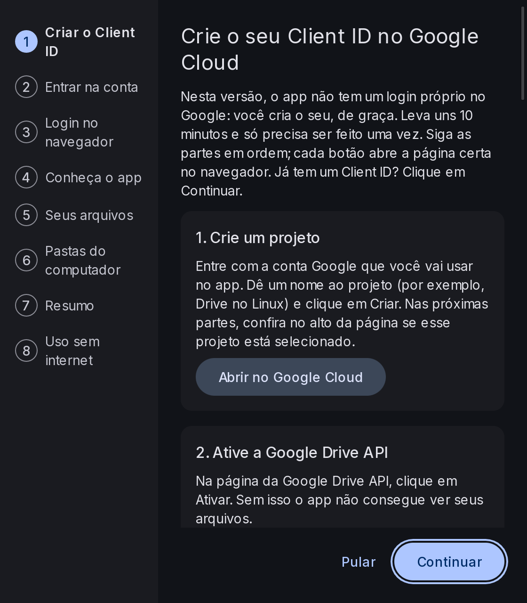 | 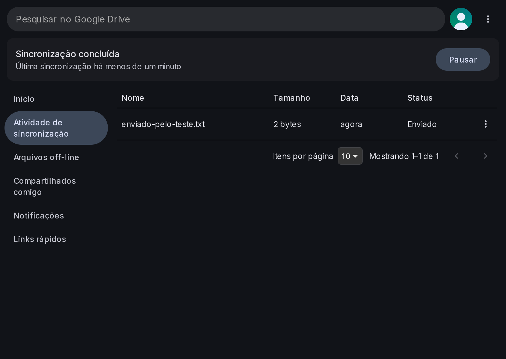 |
| **Menu da conta** | **Pesquisa rápida** |
| 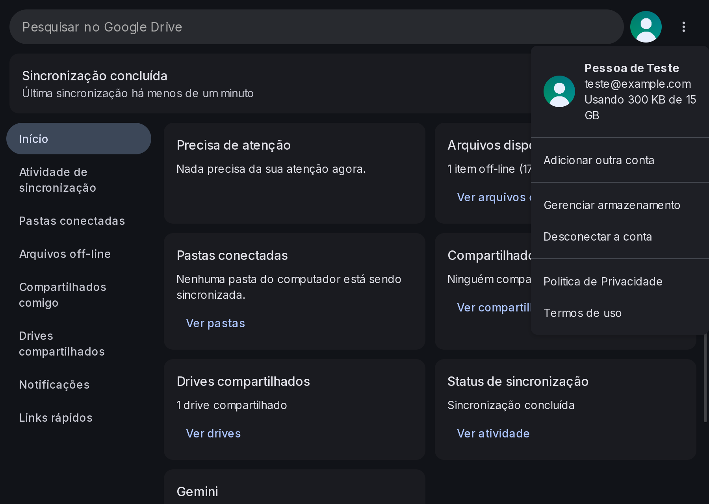 |  |
| **Arquivos off-line** | **Preferências** |
|  |  |
| **Sobre** | **Desinstalar** |
| 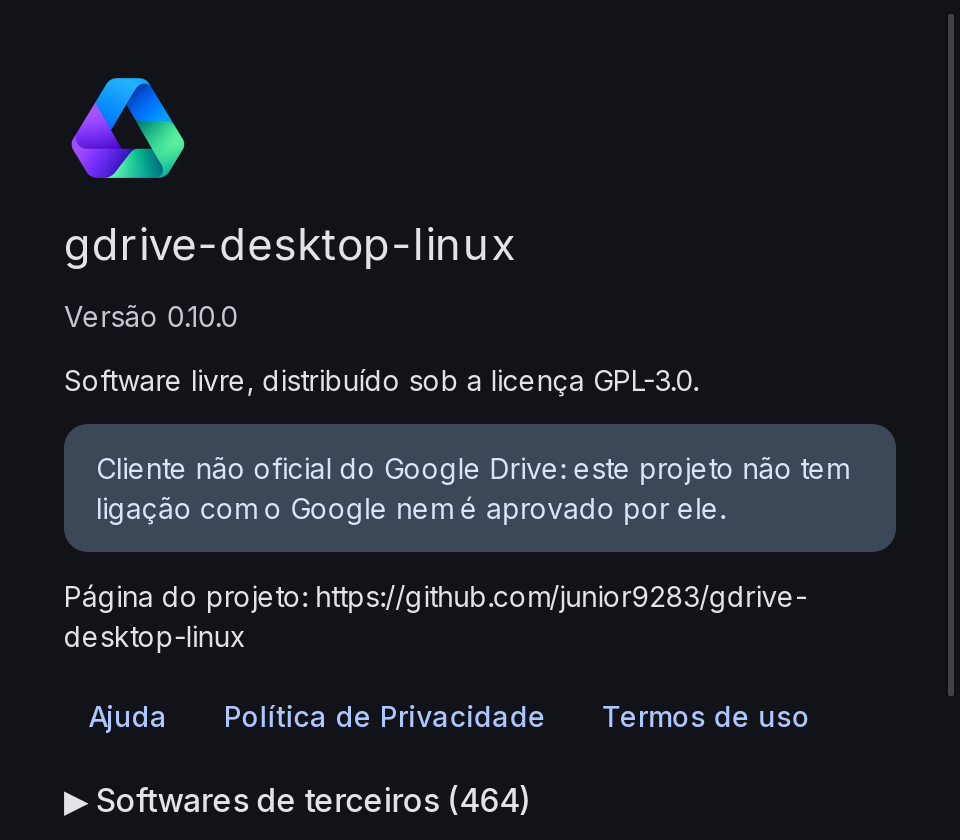 | 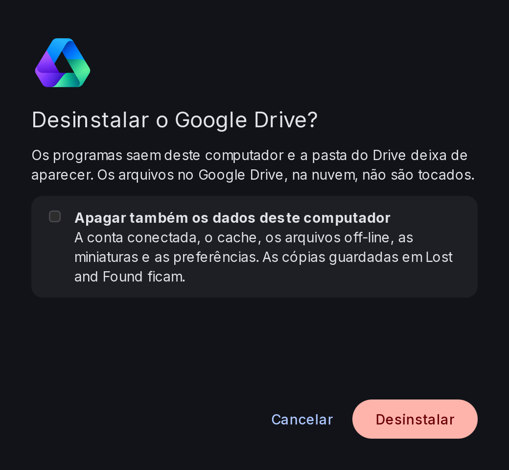 |
| **Compartilhar** | **Gerenciar versões** |
| 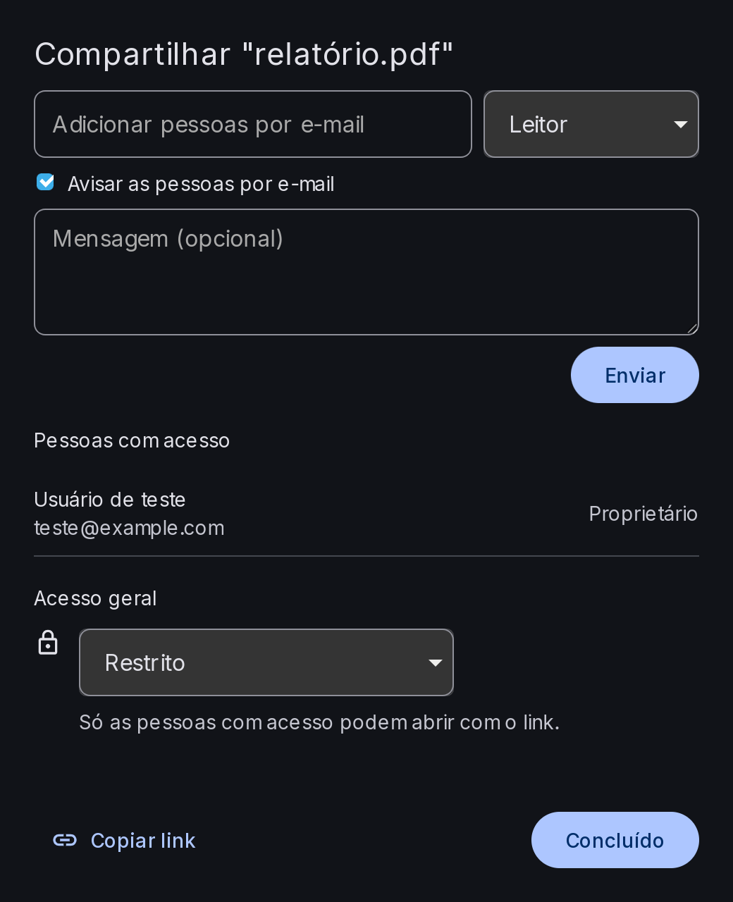 | 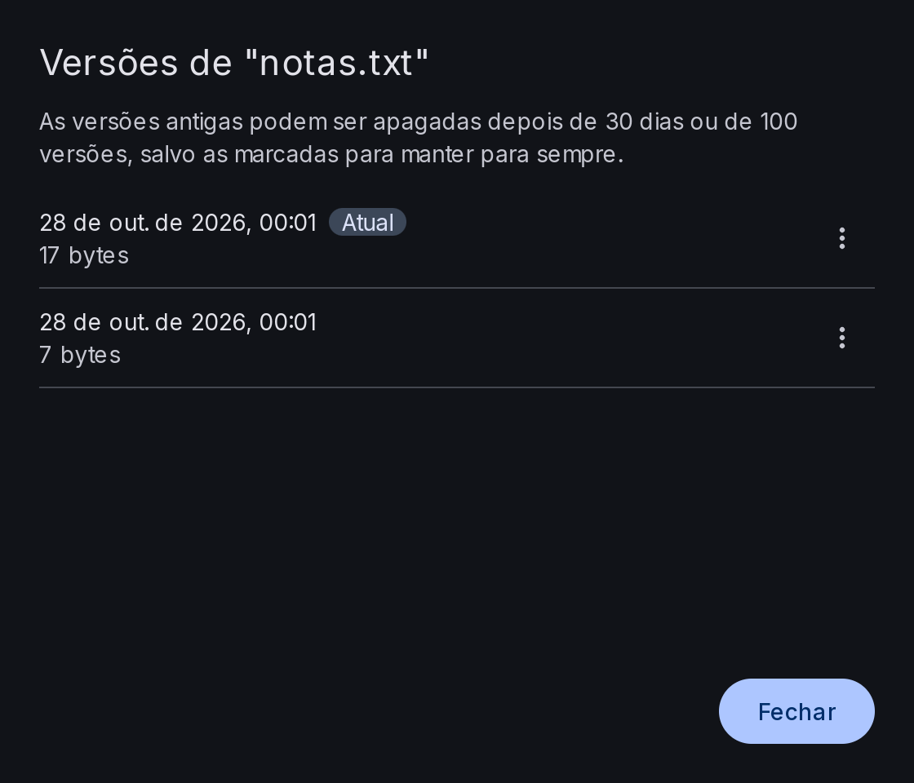 |
| **Gerenciar drives compartilhados** | **Adicionar atalho ao Drive** |
| 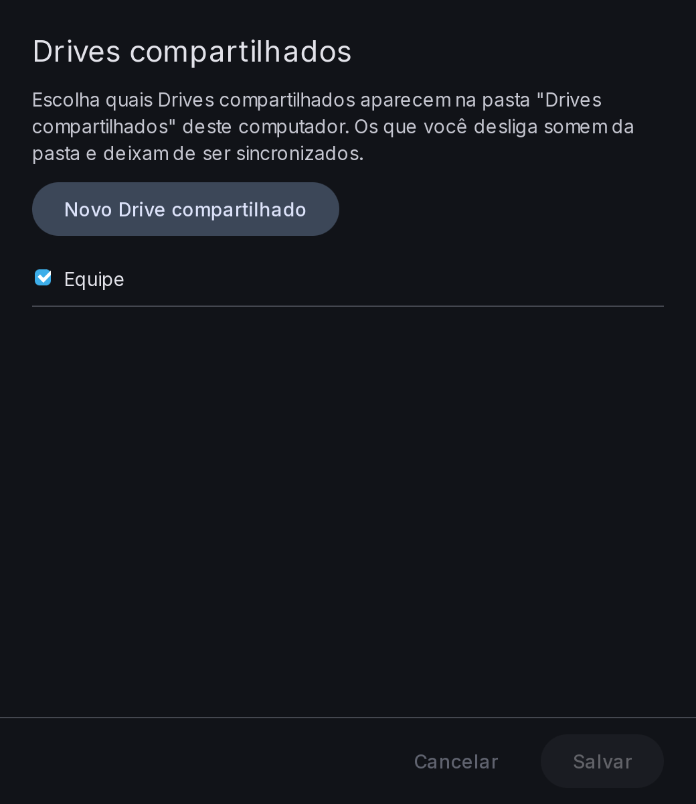 | 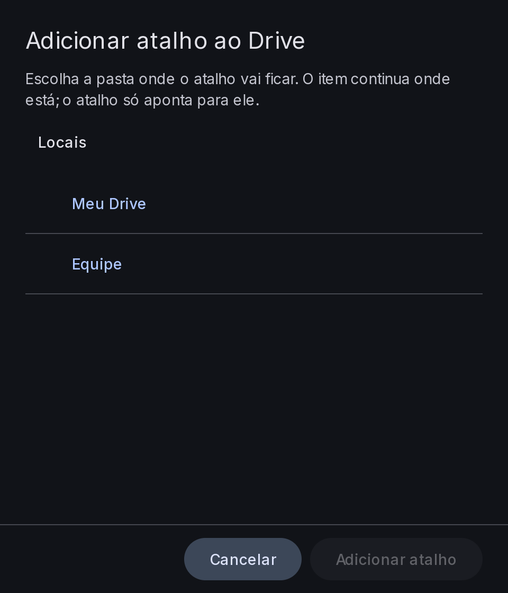 |
| **Meu computador** | **Espelhar o Meu Drive** |
| 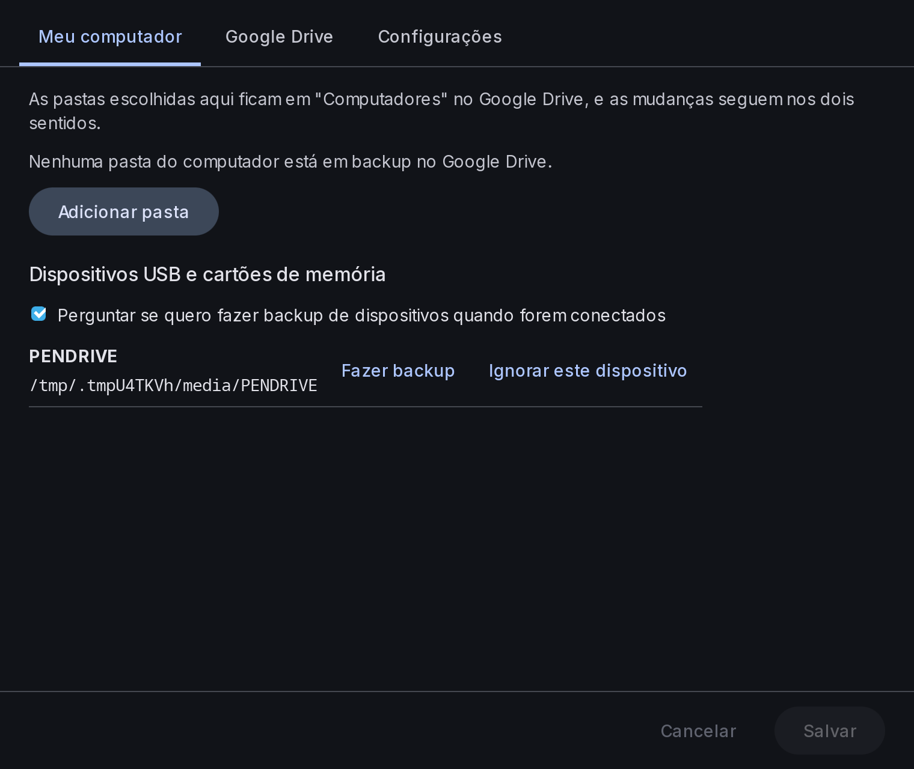 | 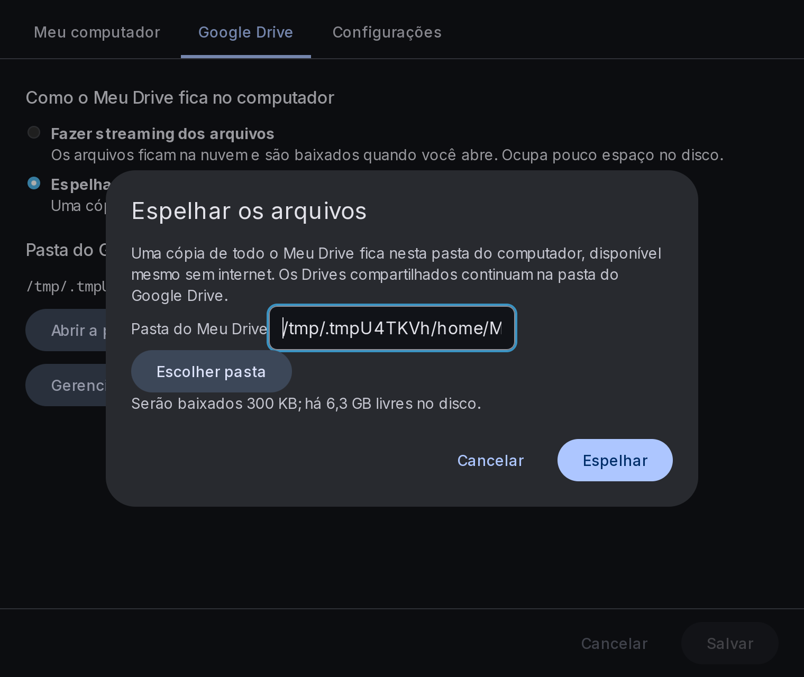 |
| **Enviar feedback** | |
| 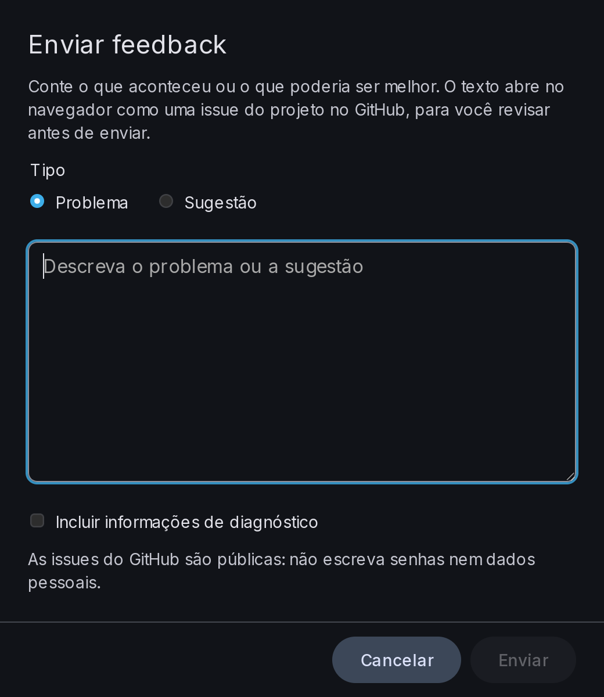 | |

## Como funciona

```
┌──────────────────────────┐      ┌───────────────────────────────┐
│ Interface (Tauri)        │      │ Gerenciadores de arquivos     │
│ bandeja, login,          │      │ (plugin do Dolphin, extensão  │
│ preferências, atividade  │      │  GTK: menu do botão direito)  │
└────────────┬─────────────┘      └───────────────┬───────────────┘
             │              D-Bus                 │
┌────────────┴────────────────────────────────────┴───────────────┐
│ Motor (serviço em Rust)                                          │
│  • pasta virtual via FUSE (arquivos sob demanda)                 │
│  • banco SQLite com os metadados de todo o Drive                 │
│  • cache em blocos (só os trechos lidos são baixados)            │
│  • fila de envios que sobrevive a reinícios e quedas de rede     │
│  • sincronização de mudanças e resolução de conflitos            │
└────────────────────────────────┬─────────────────────────────────┘
                                 │ HTTPS + OAuth 2.0
                        Google Drive API (pública)
```

### Diferenças inevitáveis em relação ao app oficial

- **Atualizações vindas da nuvem:** chegam em segundos, mas não na hora. O app oficial usa um canal
  de notificação interno do Google que não está disponível para terceiros.
- **Login:** nunca usa a identidade do app oficial. Nas versões 0.x, cada usuário cria o próprio
  Client ID no Google Cloud, seguindo o [guia passo a passo](docs/guia-client-id.md).
- **Backups de pastas:** a API pública não cria a seção "Computadores" do Drive. Os backups ficam em
  `Meu Drive/Computadores/<nome-do-computador>/`, e a pasta do app mostra "Computadores" como no
  original.
- **Pastas de rede (NAS):** não podem ser sincronizadas; o app recusa volumes de rede e FUSE.
- **"Adicionar ao espelho" no menu do Dolphin:** não existe, porque no Linux o Espelho é sempre do
  Meu Drive inteiro (não de pastas escolhidas).
- **Dispositivos:** o aviso de um pendrive novo abre as preferências, onde fica a opção de fazer
  backup sempre; os avisos do sistema não têm caixa de seleção.
- **Atalho global:** usa só o portal XDG GlobalShortcuts, que o Plasma 6 e o GNOME 48 já
  implementam; sem o portal, o atalho fica desligado e as Preferências dizem isso.
- **"Perguntar ao Gemini" no menu do Dolphin:** não há endereço público para abrir um arquivo no
  Gemini; o cartão da janela principal leva à página do Gemini.
- **Sem o limite de 4 GB por arquivo** da unidade virtual do Windows: aqui o limite é o da nuvem.
- **Ficam fora:** presença em tempo real do Office, plugins do Outlook/Meet e backup para o Google
  Fotos (descontinuado pelo próprio Google).

A especificação completa está em
[`docs/superpowers/specs/2026-10-25-gdrive-desktop-linux-design.md`](docs/superpowers/specs/2026-10-25-gdrive-desktop-linux-design.md).

## Como instalar

É uma prévia para testes: funciona no dia a dia, mas mantenha cópia do que for importante.

**1. Instalar.** Baixe da [página de releases](https://github.com/junior9283/gdrive-desktop-linux/releases/latest)
o arquivo da sua distribuição (64 bits, x86_64):

| Distribuição | Arquivo | Como instalar |
|---|---|---|
| Ubuntu 22.04+, Debian 12+, Mint, Pop!_OS | `.deb` | `sudo apt install ./gdrive-desktop-linux_*.deb` |
| Fedora, Nobara, openSUSE | `.rpm` | `sudo dnf install ./gdrive-desktop-linux-*.rpm` (openSUSE: `sudo zypper install --allow-unsigned-rpm ./…rpm`) |
| Arch, Manjaro, EndeavourOS, CachyOS | `.pkg.tar.zst` | `sudo pacman -U ./gdrive-desktop-linux-*.pkg.tar.zst` |
| Qualquer outra | `.tar.gz` | instale o FUSE 3 e o WebKitGTK 4.1 da distribuição; depois `tar -xzf gdrive-desktop-linux-*.tar.gz` e `./gdrive-desktop-linux-*/install.sh` (instala em `~/.local`, sem root) |

O `SHA256SUMS` do release confere os arquivos baixados (`sha256sum -c --ignore-missing SHA256SUMS`).

<details>
<summary>Ou compilar o código</summary>

Dependências (Rust 1.99 ou mais novo, FUSE 3 e as bibliotecas da janela):

```bash
# Fedora/Nobara
sudo dnf install fuse3 webkit2gtk4.1-devel libsoup3-devel librsvg2-devel dbus-devel
# Debian/Ubuntu
sudo apt install fuse3 libwebkit2gtk-4.1-dev librsvg2-dev libdbus-1-dev build-essential
```

Compilar e instalar para o seu usuário, sem root (em `~/.local`):

```bash
scripts/install-dev.sh                 # compila em release e instala
scripts/install-dev.sh --dry-run       # só mostra o que instalaria
scripts/install-dev.sh --prefix /outro/lugar
```

Ele instala os quatro programas (serviço, CLI, bandeja e janela), o serviço do usuário (systemd),
a ativação do serviço e da janela pelo D-Bus, o atalho no menu de aplicativos, a abertura dos
ponteiros `.gdoc`, os ícones e a extensão do menu do botão direito para Nautilus, Nemo, Caja e
Thunar. Os plugins do Dolphin (menu e emblemas de estado) compilam à parte
(`integrations/dolphin/build.sh`, com CMake e KF6) e vão na pasta de plugins do Qt do sistema.

`scripts/package.sh dist` gera os mesmos instaladores do release (precisa do
[nfpm](https://nfpm.goreleaser.com)).

</details>

**Desinstalar:** pelo item **Desinstalar Google Drive** do menu de aplicativos ou pelo botão
**Desinstalar…** em Mais opções › Sobre. A janela pergunta se apaga também os dados deste
computador (conta conectada, cache, arquivos off-line, miniaturas e preferências; as cópias do Lost
and Found ficam) e, se o app veio de um pacote, o sistema pede a senha de administrador. Pela loja
ou pelo terminal (`apt remove`, `dnf remove`, `pacman -R`) só os programas saem e os dados ficam,
como é o padrão no Linux; quem instalou pelo `.tar.gz` também pode rodar `./uninstall.sh`.

**2. Abrir:** procure **Google Drive** no menu de aplicativos (ou rode
`gdrive-desktop-linux-tray`). A bandeja liga o serviço e, sem conta, abre o primeiro uso, que
guia a criação do seu Client ID parte por parte, com botões que abrem cada página do Google Cloud
e copiam os valores (o mesmo passo a passo do [guia](docs/guia-client-id.md)). Depois, cole o
Client ID e o segredo e entre pelo navegador. A pasta aparece em `~/Google Drive/Meu Drive`.
Outras contas entram pelo menu da conta ("Adicionar outra conta") e ganham a própria pasta,
`~/Google Drive (<e-mail>)`.

Na bandeja: estado da sincronização, pausar/retomar, pesquisa (também pelo atalho global, se o
portal do KDE aceitar), lista de erros, arquivos off-line, preferências e sair. A janela
principal tem o Início, a atividade com progresso e "Cancelar envio", os compartilhados comigo e
o histórico de notificações.

**Menu do botão direito:** nos arquivos e pastas do Meu Drive e dos Drives compartilhados aparece
o submenu **Google Drive**, com abrir no navegador, compartilhar, copiar link, gerenciar versões,
adicionar atalho ao Drive, Disponível off-line / Somente on-line (marcado conforme o estado
atual), novo Documento, Planilha ou Apresentação Google na pasta, atualizar a pasta e ver a
lixeira. Na pasta "Drives compartilhados" ele cria um drive novo e abre "Gerenciar drives
compartilhados". Fora da pasta do Drive ele não aparece.

| Gerenciador | Como funciona |
|---|---|
| Dolphin (KDE Plasma 6) | plugin que vem nos pacotes `.deb`, `.rpm` e Arch (no `.tar.gz` não: o Qt só procura plugins nas pastas do sistema) |
| Nautilus (GNOME, Ubuntu, Pop!_OS 22.04, Zorin), Nemo (Cinnamon, Mint), Caja (MATE), Thunar (Xfce) | extensão que vem em todos os formatos; precisa do pacote de Python do gerenciador: `nautilus-python`/`python3-nautilus`, `nemo-python`/`python3-nemo`, `python3-caja`/`python-caja` ou `thunarx-python` |
| COSMIC Files (Pop!_OS 24.04) | não aceita extensões nem submenus: o serviço põe as ações soltas, com "Google Drive:" no nome, e elas avisam quando o item não é do Meu Drive |

Também há uma CLI:

| Comando | O que faz |
|---|---|
| `login` / `status [--account <e-mail>]` | entra numa conta / conta, pasta, envios pendentes |
| `pin <caminho>` / `unpin <caminho>` | deixa disponível off-line / só on-line |
| `pause` / `resume` | pausa e retoma a sincronização |
| `lost-and-found` | lista as edições guardadas por conflito |
| `logout [--account <e-mail> \| --all] [--finish \| --move <pasta> \| --discard]` | sai de uma conta ou de todas, decidindo o que fazer com envios pendentes (o Lost and Found nunca é apagado) |
| `open-pointer <arquivo>` | abre um `.gdoc`, `.gsheet`… no navegador (usado pelo duplo clique) |
| `menu-action <ação> <caminho>…` | faz uma ação do menu do botão direito (usado pelo COSMIC Files) |
| `uninstall [--purge] [--yes]` | desinstala o app; `--purge` apaga também os dados deste computador (desconecte a conta antes) |

**Servidor MCP:** o programa `gdrive-desktop-linux-mcp` deixa um assistente de IA compatível com
o Model Context Protocol (Claude Desktop, Claude Code e outros) consultar e organizar o Drive pelo
serviço do app, sem credencial própria: estado de sincronização de um caminho, link da web,
pastas acompanhadas, abrir a janela Compartilhar com um e-mail já digitado (nada é compartilhado
sem você confirmar) e adicionar uma pasta à sincronização — `backup` (cópia em "Computadores",
a pasta fica onde está) ou `stream` (a pasta vai para o Meu Drive e um link fica no lugar; a
original vai para a lixeira do sistema). Para registrar num cliente MCP:

```json
{
  "mcpServers": {
    "google-drive": { "command": "gdrive-desktop-linux-mcp" }
  }
}
```

No Claude Code: `claude mcp add google-drive -- gdrive-desktop-linux-mcp`.

Limitações conhecidas:

- **Vim e Neovim** (com o padrão `backupcopy=auto`) salvam renomeando o original e criando outro:
  o conteúdo não se perde, mas no Drive o arquivo ganha um ID novo e o antigo vai para a lixeira
  (links compartilhados do antigo deixam de valer). Com `set backupcopy=yes` o ID se mantém.
- Uma pasta criada aqui que ainda não subiu, mandada para a lixeira, some só deste computador.
- Uma conta que ainda não terminou a primeira leitura do Drive e não consegue subir na partida
  (sem internet ou com o login expirado) fica fora da lista até a próxima partida.
- No modo Espelho, os Drives compartilhados continuam na pasta do Google Drive (em Stream), como
  no original.

Roteiro de teste manual (e o que já foi conferido): [docs/testes](docs/testes/README.md).

## Roteiro

Cada etapa sai funcionando antes da próxima.

| Versão | Etapa |
|---|---|
| 0.0.x | Design e especificação |
| 0.1 | Motor: pasta virtual, cache, sincronização e modo off-line |
| 0.2 | Bandeja, janela, primeiro uso com login e preferências |
| 0.3 | Miniaturas do Google no gerenciador de arquivos |
| 0.4 | Instaladores para as distribuições e desinstalador |
| 0.5 | Menu do botão direito em todos os gerenciadores |
| 0.6 | Desempenho: CPU parada, pastas grandes, download e envios em paralelo |
| 0.7 | Dolphin completo: ícones de status, janelas de compartilhar e de versões |
| 0.8 | Várias contas e Drives compartilhados |
| 0.9 | Backup de pastas, pastas conectadas, modo espelho e dispositivos |
| 0.10 | Diagnóstico e feedback, notificações restantes, servidor MCP, políticas restantes, ransomware e recuperação do banco ← **estamos aqui** |
| 0.11 | Últimos itens da janela, da bandeja e das Preferências; tour de boas-vindas; limites do Drive com mensagem própria |
| 1.0 | Paridade com a versão Windows, item a item na [matriz de paridade](docs/paridade.md) |

## Versionamento

O projeto segue o [Versionamento Semântico](https://semver.org/lang/pt-BR/) (`MAIOR.MENOR.CORREÇÃO`).
Toda mudança é registrada no [CHANGELOG](CHANGELOG.md), e cada versão publicada ganha uma tag
`vX.Y.Z`.

## Como contribuir

Contribuições são bem-vindas, seja em código, testes, tradução, documentação ou relatos de uso.
A melhor forma de ajudar agora é testar a prévia e abrir uma *issue* com o que deu errado ou com
sugestões. Antes de mandar código, veja como rodar os testes em [docs/testes](docs/testes/README.md).

Uma regra vale para todos: **nenhum código, texto, ícone, fonte ou outro arquivo do Google** pode
entrar no repositório. O comportamento do app oficial pode ser estudado e descrito, mas a
implementação tem que ser própria.

## Perguntas frequentes

**É oficial?** Não. O projeto não tem vínculo com o Google.

**É seguro?** O app só acessa a sua conta pela API pública do Google, com a sua autorização
(OAuth), e o código é aberto para qualquer um conferir.

**Por que Rust?** Pela segurança de memória e pelo desempenho num serviço que fica rodando o tempo
todo e lida com os seus arquivos.

## Aviso legal

Este projeto não tem vínculo com o Google LLC nem é endossado por ele. "Google Drive" e "Google
Fotos" são marcas registradas do Google LLC e são citadas aqui apenas para indicar compatibilidade.

## Licença

[GNU GPL v3.0](LICENSE): você pode usar, estudar, modificar e redistribuir o app. Versões
modificadas distribuídas também precisam ter o código aberto.
